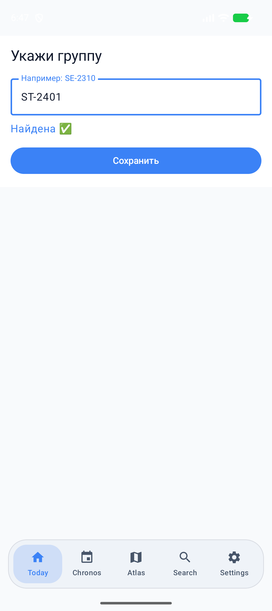
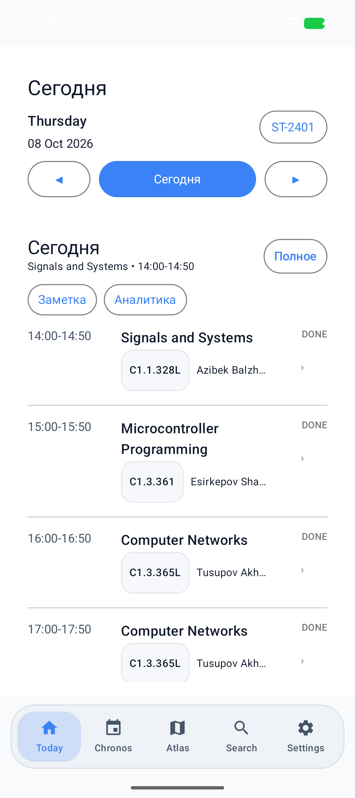
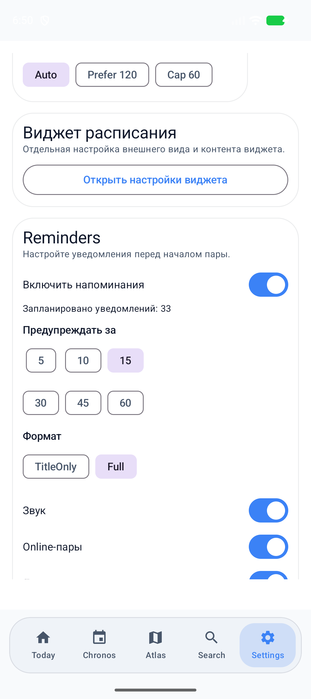

# Aitunavi — AITU Student Navigator

[](https://github.com/kanatovs/Aitunavi/actions/workflows/android.yml)

An Android application for AITU students: group and teacher schedules, a campus atlas, daily notes, and lesson reminders. Schedule data is bundled with the app; no account or schedule server is required.

## Features

- **Today:** select a group, browse dates, and view the full schedule and lesson details.
- **Search:** find teachers from the schedule and browse their lessons and recent searches.
- **Atlas:** search campus rooms and points of interest, with an embedded web map.
- **Notes:** save text and up to 10 images per date; select images, paste accessible clipboard images, and view or remove attachments.
- **Reminders:** configure lead time, online and lecture filters, quiet hours, notification format, and sound.
- **Settings:** Russian and English language options, themes, and appearance controls.

Schedules, search, and notes work offline. The web map requires an internet connection.

## Screenshots

Actual screens from the debug application running on an Android emulator:

| Group selection | Daily schedule | Reminders |
| --- | --- | --- |
|  |  |  |

## Build and run

Install JDK 21, Android SDK Platform **36.1**, and Build Tools **36.0.0**. The minimum supported device is Android 8.0 (API 26). The repository includes the Gradle Wrapper.

1. Open the repository in Android Studio and wait for Gradle synchronization.
2. Install the required SDK packages through SDK Manager.
3. Set the SDK path in an untracked `local.properties`, for example `sdk.dir=C:/Users/YourName/AppData/Local/Android/Sdk`, or set `ANDROID_HOME`.
4. Run the `app` configuration on an emulator or device.

From a terminal:

```bash
./gradlew testDebugUnitTest lintDebug assembleDebug
```

From Windows PowerShell:

```powershell
$env:JAVA_HOME = "C:/Program Files/Android/Android Studio/jbr"
$env:ANDROID_HOME = "C:/Users/YourName/AppData/Local/Android/Sdk"
./gradlew.bat testDebugUnitTest lintDebug assembleDebug
```

The debug APK is generated at `app/build/outputs/apk/debug/app-debug.apk`. It uses a development signing key; release signing and distribution are separate tasks. Successful GitHub Actions builds also upload the APK as an artifact.

## Data and project structure

| Path | Purpose |
| --- | --- |
| `app/src/main/assets/Miko.json` | Bundled group schedules |
| `app/src/main/assets/atlas_rooms.json`, `atlas_pois.json` | Campus rooms and points of interest |
| `data/parser`, `data/repository` | JSON loading and data access |
| `features/today` | Daily schedule, lesson normalization, and notes |
| `features/search`, `features/atlas`, `features/chronos` | Search, campus map, and clubs |
| `features/schedule/notifications` | Reminder planning and delivery |
| `data/datastore` | Local preferences and notes |

Built with Kotlin, Jetpack Compose, Material 3, Navigation Compose, DataStore, kotlinx.serialization, AlarmManager, and WorkManager.

The schedule is an asset snapshot and does not update automatically from a university server. Check its currency before relying on it.

## Reminder behavior

The reminder plan covers the next seven calendar days and keeps at most 60 upcoming reminders. Duplicate lesson rows are combined, including multiple rooms. The settings counter uses the same planning logic.

Rescheduling cancels the previous Android `PendingIntent` objects. Disabling reminders or clearing the selected group also cancels them. A generation token rejects stale broadcasts, and consuming a pending identifier prevents repeated delivery. Preferences are read from DataStore instead of potentially outdated UI state.

The app refreshes reminders on startup, group or reminder settings changes, device reboot, APK updates, and time or time zone changes. WorkManager requests a daily background refresh; Android may defer background work to save battery.

Reminders use [inexact AlarmManager alarms](https://developer.android.com/develop/background-work/services/alarms). Doze and battery restrictions may delay delivery, so exact timing is not guaranteed. A refresh skips reminder times that have already passed. Android 13 and later require notification permission. Sound also depends on the selected notification channel's system settings. After force-stopping the app, open it again to restore background work.

Quiet hours include the starting boundary and exclude the ending boundary. Equal boundaries mean there is no quiet interval.

## Verification

`testDebugUnitTest` covers planning dates and the seven-day window, lead time, filters, quiet hours, invalid times, room normalization, and reminder limits. Robolectric regression tests cover permission checks, publishing notification content, silent channels, group changes, cancellation, stale broadcasts, and duplicate delivery.

Run the existing device tests with an emulator or device connected:

```bash
./gradlew connectedDebugAndroidTest
```

The instrumented tests verify real `PendingIntent` cancellation, group changes, stale broadcast rejection, publication through Android's notification manager, silent channels, single delivery, and the refresh generation guard. GitHub Actions runs JVM tests, lint, APK assembly, and a separate Android emulator job. Build success alone does not verify real-device alarm timing or delivery under manufacturer battery restrictions.

## Limitations

- Localization is partial; some screens still contain hardcoded Russian text.
- Notes belong to dates and are shared across groups. Images are stored in the app's private directory.
- Clipboard paste supports accessible `content://` image URIs. Image URLs are not downloaded.
- There is no automatic schedule synchronization, user account system, or cloud note synchronization.
- Appearance settings do not guarantee a particular frame rate.
- Notification permissions and device battery restrictions should be checked on the intended physical device.
